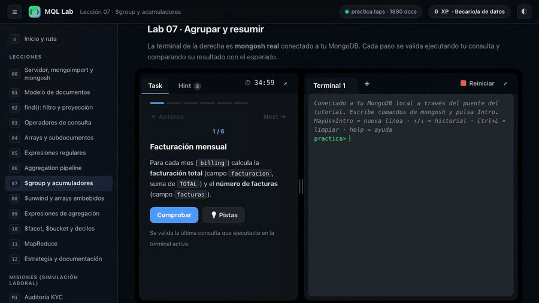
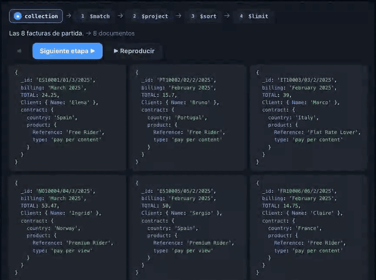
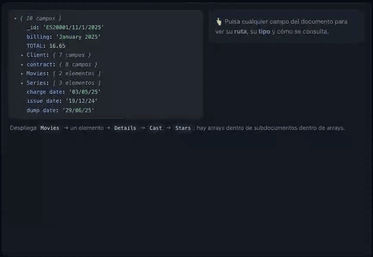
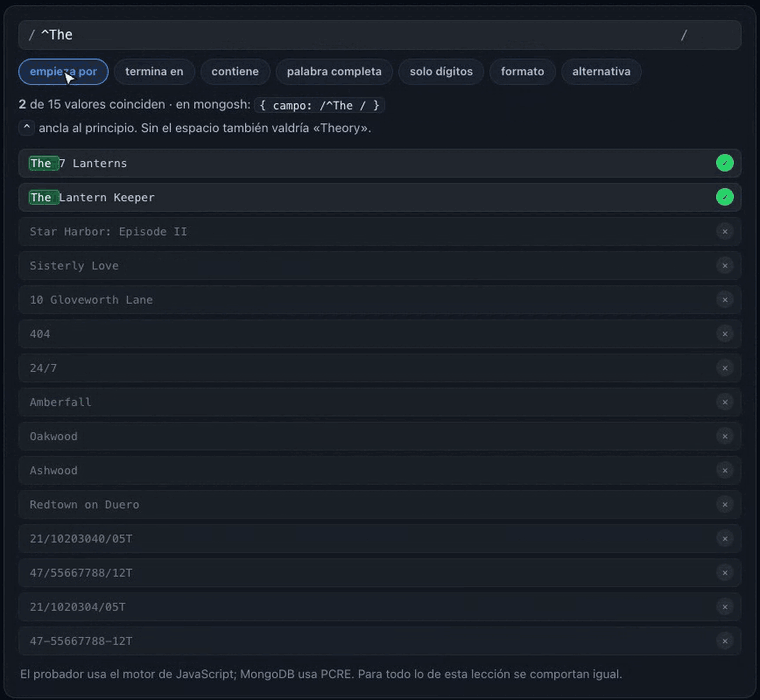
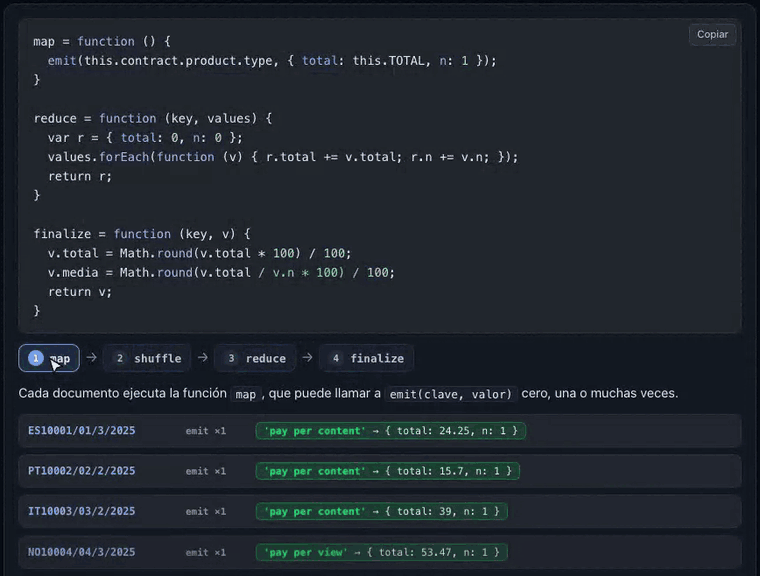
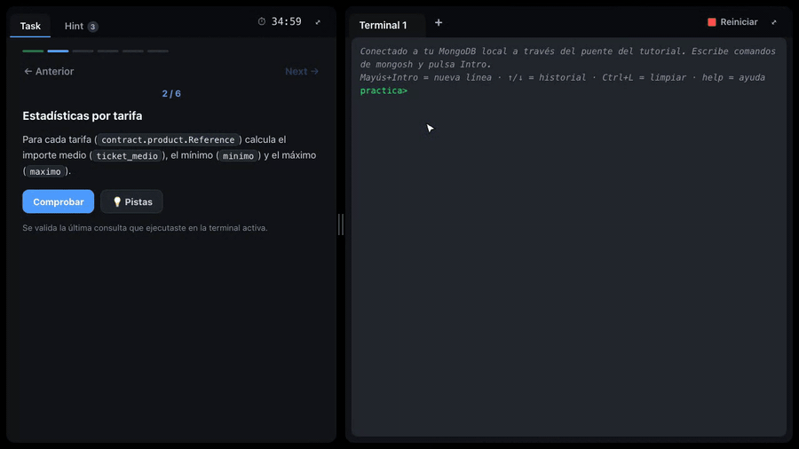
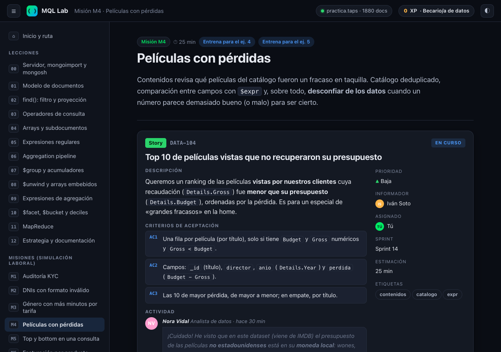
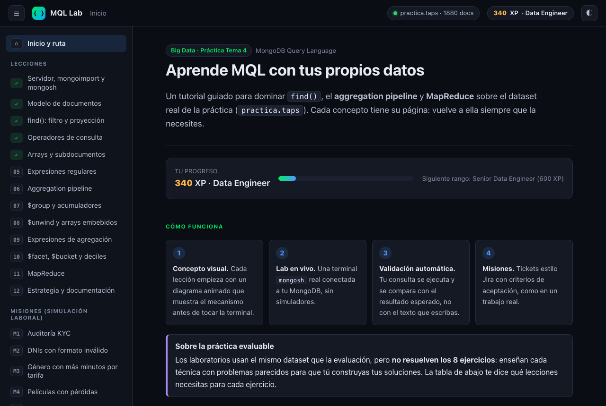
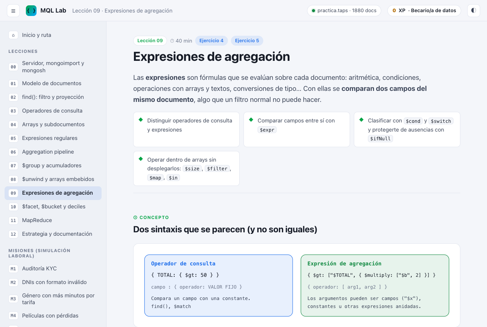

# MQL Lab · Aprende MongoDB practicando en tu propia base de datos

<p align="center">
  
</p>

<p align="center">
  <b>13 lecciones</b> &nbsp;·&nbsp; <b>6 misiones tipo ticket</b> &nbsp;·&nbsp; <b>laboratorios sobre MongoDB real</b> &nbsp;·&nbsp; <b>validación automática</b><br>
  Solo necesitas Node.js y <code>mongosh</code> · sin <code>npm install</code> · en español
</p>

Tutorial guiado para dominar **MongoDB Query Language**: `find()`, *aggregation pipeline* y *MapReduce*. Cada concepto tiene **su propia página** (para consultarla cuando la necesites), empieza con una **animación** del mecanismo y termina con un **laboratorio**: una terminal `mongosh` real, conectada a tu MongoDB, que comprueba el *estado real* de tu consulta y no el texto que escribas.

Todo el tutorial gira en torno a un dataset de **facturas mensuales de un servicio de televisión**: cada documento es la factura de un cliente en un mes, con sus datos, su contrato y las películas y series que vio. El repositorio incluye un [generador de datos de demostración inventados](#datos-de-demostración) con ese esquema, así que puedes empezar sin nada más.

## Así se aprende

### 1 · Primero entiendes el mecanismo, después tocas la terminal

Cada lección arranca con diagramas y visores interactivos construidos con datos de ejemplo: ves cómo viaja cada documento por las etapas de un pipeline, cómo se lee una ruta como `Client.Email`, cómo funciona una expresión regular o qué hacen `map`, `shuffle` y `reduce`.

<table>
  <tr>
    <td width="50%" align="center"><br><sub><b>Pipeline etapa a etapa</b>: qué le pasa a cada documento</sub></td>
    <td width="50%" align="center"><br><sub><b>Explorador de documentos</b>: ruta, tipo y consulta de cada campo</sub></td>
  </tr>
  <tr>
    <td width="50%" align="center"><br><sub><b>Probador de regex</b> con coincidencias resaltadas</sub></td>
    <td width="50%" align="center"><br><sub><b>MapReduce</b> en cuatro fases con funciones reales</sub></td>
  </tr>
</table>

### 2 · Laboratorio real con pistas progresivas (modo estudio)

Una terminal `mongosh` real a la derecha, la tarea a la izquierda. Si te atascas, hay **tres niveles de pistas** y, después, la solución, que puedes pegar en la terminal para ejecutarla y entender el resultado. Cada paso se valida **ejecutando tu consulta** y comparando su resultado con el esperado: da igual cómo la escribas.

<p align="center">
  
</p>

### 3 · Misiones como en un trabajo real

Seis tickets estilo Jira con prioridad, informador, criterios de aceptación y comentarios de compañeros que cambian los requisitos a mitad de camino, con alguna trampa de calidad de datos que hay que detectar antes de entregar. Cada ticket se resuelve en su propio laboratorio.

<p align="center">
  
</p>

### 4 · Progreso, rangos y tema claro u oscuro

XP por cada paso superado, rangos (de *Becario/a de datos* a *Arquitecto/a MongoDB*), una ruta de aprendizaje y el menú lateral ocultable. Funciona en móvil.

<table>
  <tr>
    <td width="50%" align="center"><br><sub>Ruta de aprendizaje y progreso</sub></td>
    <td width="50%" align="center"><br><sub>Tema claro y oscuro</sub></td>
  </tr>
</table>

## Temario

| # | Lección | Qué aprendes |
|---|---|---|
| 00 | Servidor, mongoimport y mongosh | Las tres piezas de MongoDB y tus primeros comandos |
| 01 | Modelo de documentos | Subdocumentos, arrays y esquemas irregulares |
| 02 | `find()`: filtro y proyección | Filtrar, elegir campos, ordenar y paginar |
| 03 | Operadores de consulta | Comparación, lógica, `$exists` y `$type` |
| 04 | Arrays y subdocumentos | `$size`, `$elemMatch`, `$all` y posiciones |
| 05 | Expresiones regulares | `$regex`, anclas y validación de formatos |
| 06 | Aggregation pipeline | Etapas, `$match`, `$project`, `$sort`, `$limit` |
| 07 | `$group` y acumuladores | Agrupar, contar, sumar y «el más frecuente» |
| 08 | `$unwind` y arrays embebidos | Desplegar arrays y elegir la granularidad |
| 09 | Expresiones de agregación | `$expr`, `$cond`, `$filter`, comparar campos |
| 10 | `$facet`, `$bucket` y deciles | Varias listas en una consulta y reparto por tramos |
| 11 | MapReduce | `map`, `reduce`, `finalize` y `out` |
| 12 | Estrategia y documentación | Cómo plantear, probar y documentar cada consulta |

**Misiones:** M1 Auditoría KYC · M2 DNIs con formato inválido · M3 Los géneros que más tiempo consumen · M4 Cine por país de producción · M5 Panel de facturación en una consulta · M6 Facturas extremas por tarifa.

## Qué necesitas

| Programa | Para qué | Versión probada |
|---|---|---|
| [Node.js](https://nodejs.org) 16 o superior | Ejecutar `server.js` (no hay que hacer `npm install`) | 22 |
| MongoDB Server (`mongod`) | La base de datos | 8.3 |
| MongoDB Shell (`mongosh`) | La terminal de los laboratorios | 2.13 |
| MongoDB Database Tools (`mongoimport`) | Cargar el dataset | 100.x |
| Una collection de facturas con el esquema del tutorial (o el [dataset de demostración](#datos-de-demostración)) | Los datos | — |

> Probado en **macOS** (Apple Silicon). Las instrucciones de Linux siguen las guías oficiales, pero no se han verificado en esta máquina.

## Instalación

### macOS

Con [Homebrew](https://brew.sh):

```bash
brew tap mongodb/brew
brew install node mongodb-community mongosh mongodb-database-tools
brew services start mongodb-community     # arranca mongod y lo deja en segundo plano
```

Comprueba que el servidor responde:

```bash
mongosh --quiet --eval 'db.version()'
```

### Linux

1. **Node.js 16+**: usa el gestor de paquetes de tu distribución si ofrece una versión suficiente (`node -v`), o [nvm](https://github.com/nvm-sh/nvm) / [NodeSource](https://github.com/nodesource/distributions).
2. **MongoDB Server**: sigue la guía oficial de tu distribución: <https://www.mongodb.com/docs/manual/administration/install-on-linux/>
3. **mongosh**: <https://www.mongodb.com/try/download/shell>
4. **Database Tools** (`mongoimport`): <https://www.mongodb.com/try/download/database-tools>
5. Arranca el servidor:

   ```bash
   sudo systemctl start mongod        # y, si quieres, `sudo systemctl enable mongod`
   mongosh --quiet --eval 'db.version()'
   ```

### Alternativa sin instalar servicios (macOS y Linux)

Si has descargado los binarios `.tgz` de MongoDB (sin permisos de administrador), arranca el servidor a mano en una carpeta tuya y déjalo corriendo en una terminal:

```bash
mkdir -p ~/mongodb-data
./mongod --dbpath ~/mongodb-data       # desde la carpeta bin/ del paquete descargado
```

No hace falta ponerlos en el `PATH`: el servidor del tutorial busca `mongosh` también en `~/Downloads`, `~/bin` y rutas habituales. Si no lo encuentra, indica su ruta (ver [Configuración](#configuración)).

## Datos de demostración

El repositorio incluye un generador de **datos totalmente inventados** (clientes, películas y series ficticios) con el esquema que usa el tutorial, incluidas sus irregularidades: facturas sin películas, teléfonos ausentes, apellidos dobles… Con `mongod` en marcha:

```bash
node demo/generate-demo-data.mjs
mongoimport --db demo --collection facturas --file demo/demo-data.json
```

Si tienes tu propio volcado con el mismo esquema, impórtalo igual (`mongoimport --db <database> --collection <collection> --file <fichero>.json`): el tutorial detecta solo cualquier collection que tenga la forma de las facturas (campos `Client`, `contract` y `billing`). Todas las imágenes de este README se grabaron con el dataset de demostración.

## Arrancar el tutorial

```bash
git clone <url-del-repositorio> mql-lab
cd mql-lab
node server.js
```

Se abre el navegador en <http://localhost:3000>. Pulsa `Ctrl+C` en la terminal para parar. Si el puerto 3000 está ocupado, usa el siguiente libre y lo indica en la terminal.

| Comando | Qué hace |
|---|---|
| `node server.js` | Arranca y abre el navegador |
| `node server.js --check` | Diagnostica tu instalación y sale (Node, mongosh, MongoDB, dataset) |
| `node server.js --no-open` | Arranca sin abrir el navegador (útil en servidores sin entorno gráfico) |
| `node server.js --port 4000` | Usa otro puerto |

## Configuración

Por defecto todo es **automático**: el servidor localiza `mongosh` y la collection con los datos. Si la detección falla, copia la plantilla y fija los valores a mano:

```bash
cp config.example.json config.json     # config.json está en .gitignore: es solo tuyo
```

| Opción en `config.json` | Variable de entorno | Ejemplo |
|---|---|---|
| `mongosh` | `MONGOSH_PATH` | `/usr/local/bin/mongosh` |
| `mongoUri` | `MQL_URI` | `mongodb://127.0.0.1:27017` |
| `database` | `MQL_DB` | `demo` |
| `collection` | `MQL_COLLECTION` | `facturas` |
| `port` | `PORT` | `4000` |

Las variables de entorno tienen prioridad sobre `config.json`. Ejemplo: `MQL_DB=demo MQL_COLLECTION=facturas node server.js`.

## Si algo falla

Ejecuta primero `node server.js --check`: dice qué encuentra y qué hacer.

| Mensaje | Causa y solución |
|---|---|
| «No encuentro mongosh» | Instálalo o indica su ruta en `MONGOSH_PATH`. |
| «MongoDB no responde» | `mongod` no está arrancado: `brew services start mongodb-community` (macOS) o `sudo systemctl start mongod` (Linux). |
| «Falta el dataset» | Carga tus datos o los de [demostración](#datos-de-demostración). |
| `command not found: mongoimport` | Instala MongoDB Database Tools: desde MongoDB 6 no vienen con el servidor. |
| El navegador no se abre (Linux) | Usa `node server.js --no-open` y abre la URL a mano. |

## Seguridad

- El servidor solo escucha en `127.0.0.1`: nadie más puede usarlo desde la red.
- Bloquea operaciones de escritura (`insert`, `update`, `drop`, `createIndex`…) para evitar accidentes. Es una ayuda para aprender, **no** una barrera de seguridad.
- `mapReduce` con `out` y `$out` / `$merge` solo pueden escribir en la base de prácticas `mql_tutorial`, nunca en tus datos.
- El progreso (XP y pasos superados) se guarda solo en el `localStorage` de tu navegador.

## Estructura del proyecto

```
server.js              Servidor local: sirve la web y controla sesiones de mongosh
config.example.json    Plantilla de configuración (copia a config.json si la necesitas)
index.html             Ruta de aprendizaje y progreso
lecciones/             13 lecciones (HTML generado)
misiones/              6 misiones estilo ticket (HTML generado)
assets/                Estilos, laboratorio, visualizaciones y mingo (para los ejemplos animados)
demo/                  Generador de datos de demostración inventados
docs/media/            Imágenes y GIF de este README
tools/                 Grabador de las imágenes del README
_build/                Generador de las páginas: manifest.mjs, build.mjs y content/*.mjs
```

### Modificar o ampliar las lecciones

Las páginas de `lecciones/` y `misiones/` se **generan** desde `_build/content/*.mjs`. Edita el fichero de contenido y vuelve a generar:

```bash
node _build/build.mjs
```

### Regenerar las imágenes del README

Las imágenes se graban automáticamente sobre el tutorial real, con el dataset de demostración (nunca con datos reales). Necesitas `ffmpeg`, un Chromium y `playwright-core`:

```bash
npm i --no-save playwright-core && npx playwright install chromium
node demo/generate-demo-data.mjs
mongoimport --db demo --collection facturas --file demo/demo-data.json
node server.js --no-open &                 # en otra terminal, si prefieres
node tools/record-media.cjs                # todo; o --only laboratorio,regex
```

## Créditos

- [mingo](https://github.com/kofrasa/mingo) (MIT) se incluye en `assets/mingo.min.js` y alimenta las visualizaciones animadas del navegador. Los laboratorios no lo usan: ejecutan MongoDB real.
# fintech-bigdata-practice-mql
